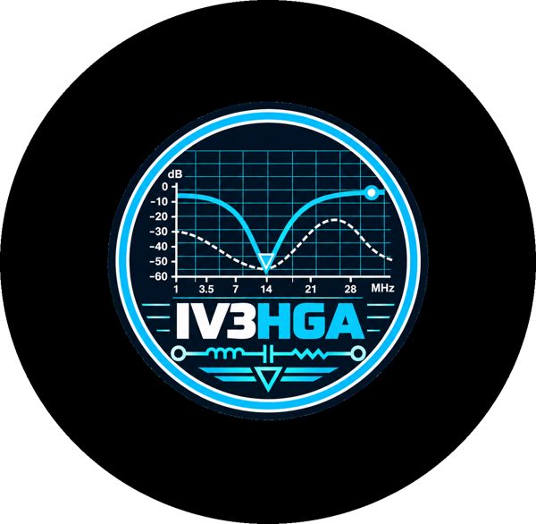

<p align="center"></p>

# Ham Radio Pills

Brevi presentazioni tecniche per radioamatori e appassionati di RF, a cura di **Elia, IV3HGA**.
🌐 **Sito del corso: https://metallarox.github.io/hamradio-pills/**

Ogni "pillola" è un PDF pronto da leggere o proiettare, accompagnato dai sorgenti Python che lo generano (simulazioni, grafici e slide).

| Modulo | Presentazione | Slide | Argomenti |
|---|---|---|---|
| 1 | [Come funziona un VNA](01-vna-come-funziona/VNA_Come_Funziona_IV3HGA.pdf) | 15 | Parametri S, architettura, ricevitori, direttività, modello d'errore, calibrazione SOL/SOLT/TRL |
| 2 | [La carta di Smith](02-carta-di-smith/Carta_di_Smith_IV3HGA.pdf) | 13 | Lettura, movimenti, dipolo, rete a L, stub, linee con perdite, λ/4, accordatore |
| 3 | [Misurare un quarzo con il VNA](03-quarzo-vna/Quarzo_VNA_IV3HGA.pdf) | 10 | Modello BVD, misura in S21 e in S11, estrazione di Rm, Lm, Cm, C0 e Q |
| 4 | [Misure inconsuete con il VNA](04-vna-misure-inconsuete/VNA_Misure_Inconsuete_IV3HGA.pdf) | 15 | Ferriti, SRF/ESR, choke, shunt-through, TDR, εr del PCB, umidità, grid-dip, k, isolamento, time-gating |

## Rigenerare un PDF

Servono Python 3 con `numpy`, `matplotlib`, `scipy`, `Pillow` e `playwright` (Chromium).

```bash
cd 02-carta-di-smith/src     # o un'altra cartella
python3 sims.py              # simulazioni e grafici (sim.py / sim11.py per il modulo 3)
python3 build.py             # genera slides.html
python3 pdf.py               # stampa il PDF in src/
```

I grafici e gli esempi numerici derivano da simulazioni, non da misure reali.

---
73 de IV3HGA
